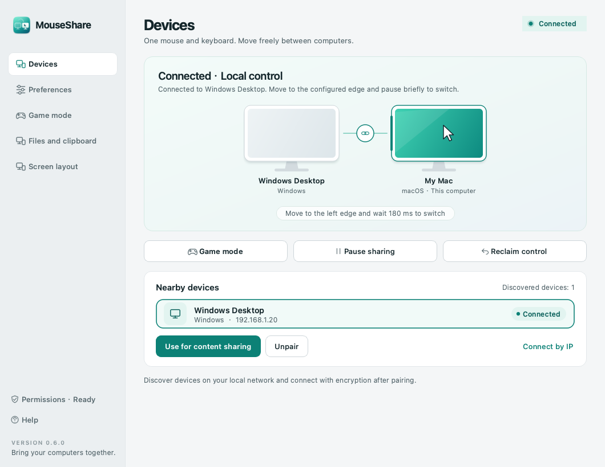
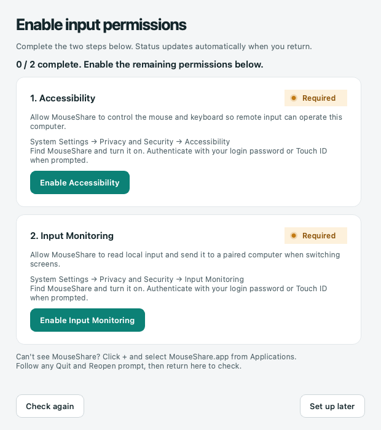
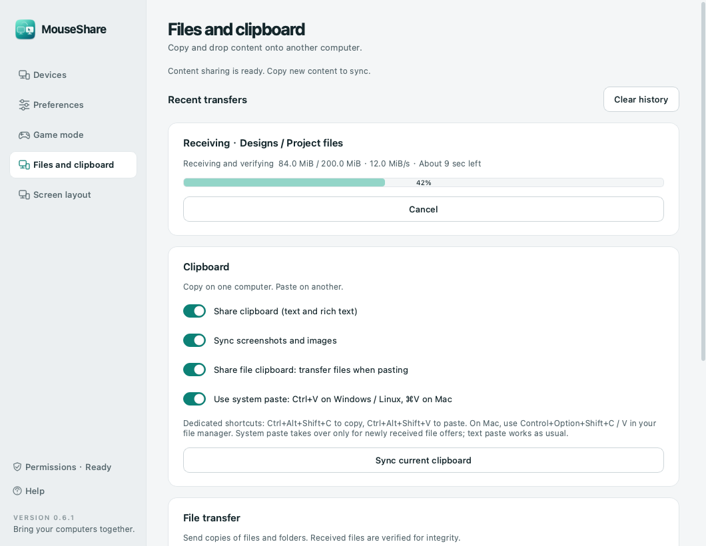
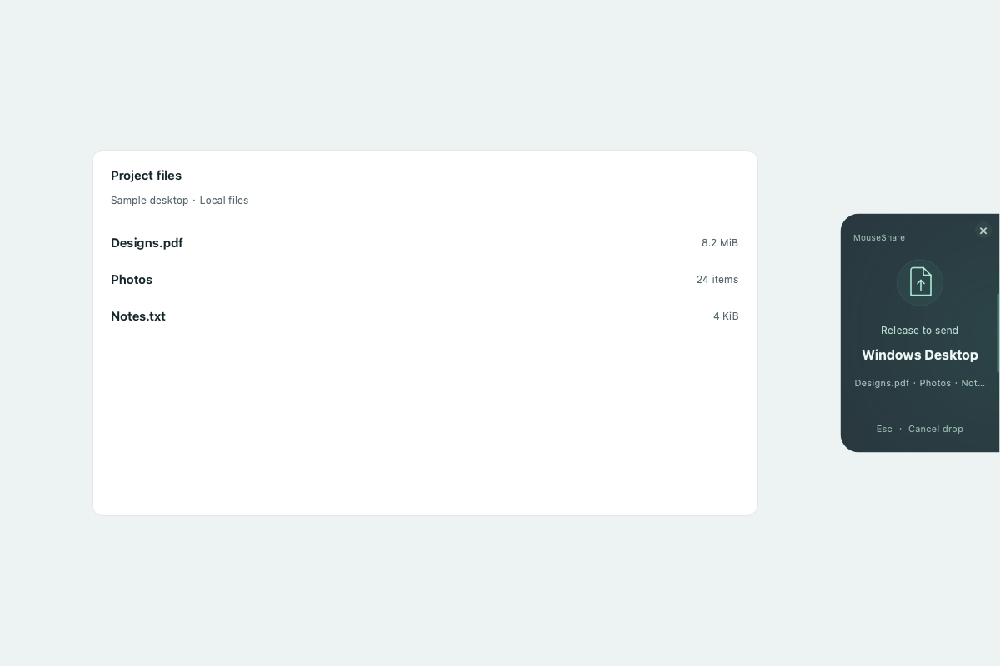
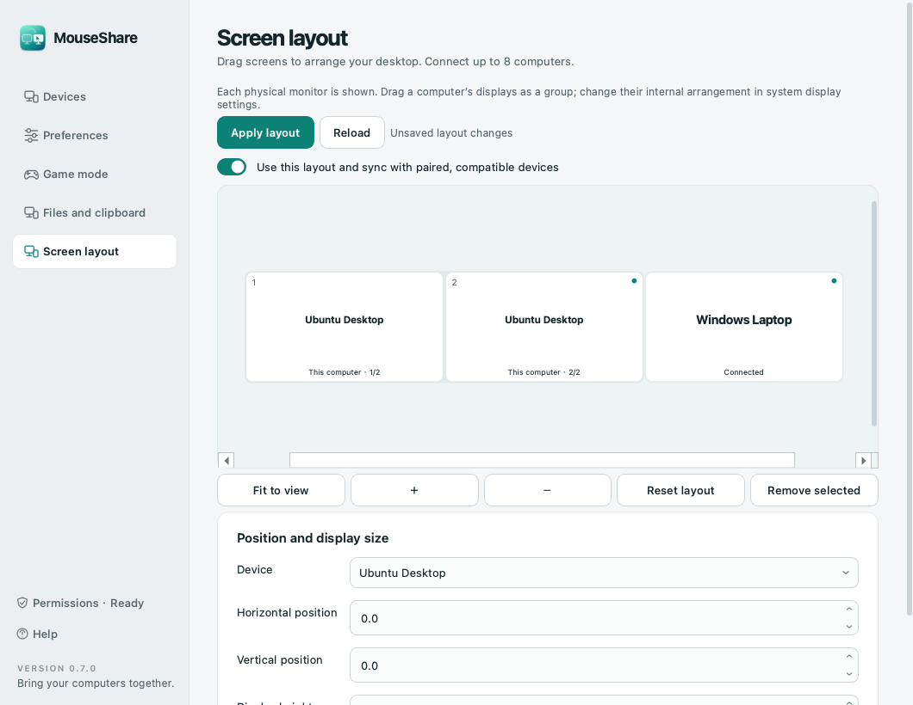
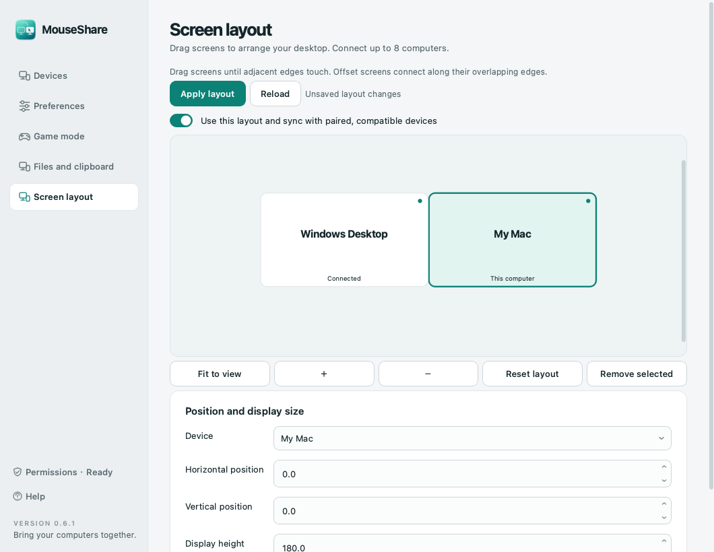

# MouseShare

[简体中文](README.md) · [English](README.en.md)

Share a keyboard, mouse, clipboard and files between **Windows, macOS and Linux (X11)** over your LAN. Move to a connected screen edge to switch immediately. Move back through the opposite edge to return.

[Download](https://github.com/413180794/MouseShare/releases) · [Builds](https://github.com/413180794/MouseShare/actions) · [Acceptance checklist](docs/ACCEPTANCE.md)

**v0.7.5 is a preview.** Automated tests cover authenticated two/three-node TLS peers and ownership recovery. Real desktop interaction, OS permissions and individual games require acceptance on your devices. Linux is tested with isolated Xvfb displays; no physical Linux computer was available.



## Language

The app supports **English and Simplified Chinese** on Windows, macOS and Linux. It follows the system language on first launch (Chinese locales use Simplified Chinese; other locales use English). Choose **Preferences → Local preferences → Language** to override it. Changes take effect immediately and are remembered on this computer, while connections, transfers and unsaved settings remain in place. Help opens the matching README. macOS system permission prompts follow the system language.

## Install

| Platform | Package | Installation |
| --- | --- | --- |
| Windows 10/11 x64 | `MouseShare-0.7.5-Windows-x64-Setup.exe` | Run Setup; retain private-LAN firewall rules |
| Windows portable | `MouseShare-0.7.5-Windows-x64-portable.zip` | Extract everything and run `MouseShare.exe` |
| Apple Silicon, macOS 13+ | `MouseShare-0.7.5-macOS-arm64.dmg` | Drag the app into Applications |
| Intel, macOS 13+ | `MouseShare-0.7.5-macOS-x86_64.dmg` | Drag the app into Applications |
| Linux x64, Ubuntu 22.04+ / Debian 12+ | `MouseShare-0.7.5-Linux-x64.deb` or `.tar.gz` | `sudo apt install ./package.deb`; or extract the portable archive |
| Linux ARM64, Ubuntu 24.04+ / Debian 13+ | `MouseShare-0.7.5-Linux-arm64.deb` or `.tar.gz` | Same as above |

Packages include Python and Qt. Linux still requires X11/Qt system libraries; the DEB declares these dependencies. The portable archive includes a user-level `install.sh` that adds a menu entry and preserves older version directories. See [Linux instructions](docs/INSTALL-Linux.txt).

Releases currently have no commercial code signing or Apple notarization. Verify the source and `SHA256SUMS.txt`. Use `Get-FileHash -Algorithm SHA256` on Windows or `shasum -a 256` on macOS. Windows SmartScreen may show an unknown publisher; macOS may require Open Anyway in System Settings → Privacy & Security. Keep system security features enabled.

For portable Linux builds on minimal desktops, install the following Qt/X11 runtime libraries. The DEB resolves its complete dependency list automatically:

```bash
sudo apt install libx11-6 libxi6 libxtst6 libxfixes3 libxrandr2 libxss1 \
  libxkbcommon-x11-0 libxcb-cursor0 libxcb-icccm4 libxcb-image0 \
  libxcb-keysyms1 libxcb-shape0 libxcb-render-util0 libxcb-xinerama0 \
  libegl1 libopengl0 libdbus-1-3
```

### macOS permissions

The first launch opens a guide when permissions are missing. Open it later from **System permissions**. Each step requests its corresponding native permission, opens the correct settings page, and checks the status when you return:

1. **Accessibility** allows MouseShare to control the keyboard and mouse.
2. **Input Monitoring** allows it to read physical input for forwarding.
3. Allow **Local Network** when prompted, and allow inbound connections if your Mac firewall requires it.

Enable MouseShare in System Settings → Privacy & Security. Use `+` to add `/Applications/MouseShare.app` if missing. Complete OS authentication yourself, and quit/reopen if macOS asks. Replacing an ad hoc signed preview may require refreshing these grants.



### Linux sessions

Full input sharing requires an **X11/Xorg** session and runs as the logged-in desktop user. Root access, membership in the `input` group and `xhost` changes are unnecessary. Linux uses XInput2 raw events, XTEST injection and active grabs to keep the source cursor at its handoff position.

On **Wayland**, this release offers file transfer and foreground clipboard buttons: **Sync current clipboard** and **Apply received clipboard**. For full keyboard/mouse sharing, log out and choose Ubuntu on Xorg or Plasma (X11) in your login session menu. Native Wayland input portals remain future work.

## Pair your computers

1. Connect both computers to the same trusted LAN and start MouseShare.
2. On **Devices**, select the nearby computer and choose Pair and connect. Discovery uses multicast and broadcast.
3. **Compare the six-digit code on both computers and approve on both.** Only approve connections you intended. The certificate fingerprint is remembered for reconnection.
4. Open **Screen layout**. Drag computer rectangles to match your desk, join the desired edges, then save. Offsets and relative screen sizes are editable. Layouts synchronize to paired v0.5.0+ participants; the original two-computer direction setting is available when layout mode is disabled.
5. Move to an overlapping shared edge to switch immediately. Input can continue A→B→C and back through the arrangement. Gaps, uncovered edges and offline neighbors stop the pointer. Up to eight computers are supported; independently pair every two computers that need direct control or file transfers.

If discovery is unavailable, expand Connect by IP and enter the other computer's IPv4 address. Allow **UDP 24871 and TCP 24872** on your trusted LAN. The Windows installer offers inbound rules restricted to the local subnet on private networks. Guest Wi-Fi isolation, VPNs, different subnets and firewalls can affect discovery.

## Game mode and recovery

| Action | Windows | macOS | Linux X11 |
| --- | --- | --- | --- |
| Toggle manual game mode | `Ctrl+Alt+F12` | `Control+Option+F12` (Fn may be needed) | `Ctrl+Alt+Shift+G` |
| Reclaim input immediately | `Ctrl+Alt+Esc` | `Control+Option+Esc` | `Ctrl+Alt+Shift+Esc` |

Game mode keeps physical input on this computer and pauses sharing in both directions, including clipboard/files. Manual mode persists across restarts. Controls are available in the app and tray/menu bar. Linux shortcuts avoid Ctrl+Alt+F-key virtual-terminal switching.

Windows automatically protects foreground fullscreen windows and named game executables. The defaults include Delta Force, League of Legends/TFT, VALORANT, CS2, PUBG, Apex, Fortnite, Overwatch, NARAKA, Genshin Impact, Honkai: Star Rail, Zenless Zone Zero, Marvel Rivals, Black Myth: Wukong, ARC Raiders, Battlefield 6 and more. See the [complete editable catalog](docs/GAMES.md).

The original three-entry stock list upgrades automatically. Custom lists are preserved; **Add popular games** adds missing popular defaults without deleting your entries. Save to apply. Names are exact foreground executable basenames, matched case-insensitively. Launchers and generic Java processes are excluded.

Fullscreen videos also trigger fullscreen protection. You can disable that option while retaining game-process detection. macOS and Linux currently offer manual game mode. If an automatic condition remains active, turning off manual mode keeps protection enabled and shows the reason. Individual anticheat systems and games still require device testing.

Physical input on a receiving computer reclaims control. Holding a key or mouse button prevents accidental edge switching. Disconnect or heartbeat timeout releases remote held inputs after about 3.5 seconds.

## Clipboard and files

New text, HTML and images copied after connection sync automatically on Windows/macOS/X11. Files are fetched when you paste: copy files on the source, then press Ctrl+Alt+V in the destination window. Ctrl+Alt+C is a dedicated copy command; macOS uses Control+Option+C/V. Optional native Ctrl+V/Command+V interception applies only to fresh remote file offers. Automatic paste requires the original focus, input activity and clipboard to remain unchanged; otherwise use the completed transfer record. Explicit sends still offer receive confirmation; the completed record also offers Copy Files and a drag-out button. You can drop files onto the app. The optional edge drop surface shows a compact glass hint near the entry point when dragging local files onto a connected screen edge. A slow glow and slight icon drift keep the hint gentle while the drop target stays fixed. Release to send, or press Esc to cancel; idle desktops stay clear. It also works when remote input controls the source file manager.

Transfers show progress, speed and estimated time, support cancellation/re-send, and save batches in separate folders to preserve existing filenames. Each file is verified with SHA-256. The default receive directory is `Downloads/MouseShare`; it is configurable. The latest 20 completed/failed records store metadata locally. Clearing records keeps received files.

- File batches: up to **100 GiB / 4096 entries**.
- Text and HTML combined: **2 MiB**. Entire clipboard payload: **8 MiB**. Images: **16 million pixels**.
- Clipboard content from before connection stays local; copy again to send. Received content is marked to avoid loops. Marked private password-manager formats are skipped; ordinary text follows your sharing settings.
- Game mode, pause, lock and disconnect stop sharing. Incomplete file transfers are cleaned up. Re-send starts from the beginning.
- Native continuous file dragging across screen edges remains future work. The current flow uses the glass drop surface, transfer, then local drag-out. macOS and Windows 11 request native compositor blur; other desktops and reduced-transparency settings use a dark translucent fallback. No screen capture or Screen Recording permission is required.
- Content sharing is compatible with v0.3.0+; Linux requires v0.4.0+; multi-computer layouts and on-demand file paste require v0.5.0+ on participating devices. Wayland uses explicit foreground clipboard actions, and received files are copied through the record's Copy Files button.






Enable optional file prefetch to populate the real system file clipboard after receiving and verifying up to 64 MiB per copy. System context-menu Paste then works. New local clipboard content is preserved; use shared paste to fetch larger files on demand. The original four-key shortcuts remain supported.

The optional file-manager extension adds **Receive files here (MouseShare)**: on Windows 11 use **Show more options**. Ubuntu GNOME requires `python3-nautilus` and reopening Files. Files are received in a separate batch folder inside the selected directory, preserving existing files. Disable the extension to remove it; disable it before uninstalling on Linux.

A laptop can use its built-in keyboard and trackpad. Cross with the trackpad, use **Control this computer**, or press **Ctrl+Alt+Space** (Control+Option+Space on Mac) to switch to the selected peer. Press again to reclaim. Input ownership still has one physical source; input on the receiving computer reclaims local control.



## Everyday use and limits

Closing the window keeps the app in the tray/menu bar where available. Login startup is opt-in. Forward and return handoffs start immediately at a connected edge. Receiver speed is adjustable from 0.25–4×.

Physical keyboard positions use USB HID IDs; the receiver's layout and IME produce text. The Windows key maps to macOS Command, Ctrl to Control. Enable Swap Ctrl and Command/Win on the receiver to change this behavior. On X11, the standard evdev/XKB keycode layout is used; relative mice and standard wheels are covered. Tablets, custom keycode maps and specific gaming drivers need acceptance.

Each instance connects to up to seven peers. Every physical display is shown, with negative coordinates and offset displays supported. Displays on the same computer preserve the system arrangement and move as a group. Change their internal arrangement in system display settings. For existing layouts, Reset arrangement and Save adopts the new overall aspect ratio. The source cursor hides during forwarding and restores on return or failure. The receiver has an optional colored pointer ring. Independently dragging each monitor of the same computer, continuous native cross-computer file dragging, resumable transfers, video streaming and Windows ARM packages remain future work. Login/lock screens, UAC secure desktops, macOS Secure Input and elevated target applications can restrict injection. See [Microsoft's SendInput restrictions](https://learn.microsoft.com/en-us/windows/win32/api/winuser/nf-winuser-sendinput).



## Local data and security

Input, clipboard and files use TLS 1.2+. Each device generates a P-256 certificate/key. Pairing commits to challenges before revealing them, proves key possession, and derives the code you compare. Future connections pin the exact certificate fingerprint. Data channels require the same peer to have an active authenticated control connection and reuse the existing TCP port. Discovery only locates addresses.

There is no cloud relay or account service. Key contents are not written to logs/configuration. LAN devices can see broadcast device names and addresses. The protocol has not had an independent security audit; use a trusted network and reject unexpected pairing requests.

| System | Data directory |
| --- | --- |
| Windows | `%LOCALAPPDATA%\MouseShare` |
| macOS | `~/Library/Application Support/MouseShare` |
| Linux | `${XDG_CONFIG_HOME:-~/.config}/MouseShare` |

Protect settings, transfer metadata, certificates and private keys. Uninstalling preserves data and received files. To fully reset, disable login startup, quit, then remove the data directory. macOS login startup uses `~/Library/LaunchAgents/io.github.makesail.mouseshare.plist`; Linux uses `${XDG_CONFIG_HOME:-~/.config}/autostart/mouseshare.desktop`.

## Development

Use Python 3.13 for release builds. Dependencies are pinned; native input runs off the GUI thread.

```sh
python3.13 -m venv .venv
# macOS/Linux: source .venv/bin/activate
# Windows: .venv\Scripts\Activate.ps1
python -m pip install ".[dev]"
python -m pytest -q
python -m ruff check .
python -m mouseshare --smoke-test
python -m mouseshare
python scripts/build.py
```

`--demo` starts the UI without input/network; `--minimized` starts in the tray. Use the packaged Mac app for system authorization; Python/terminal development may receive separate grants.

Build on the target OS/architecture. Windows needs Inno Setup 6, macOS needs command-line tools and `iconutil`, and Linux needs `dpkg-deb` plus X11/Qt libraries. GitHub Actions builds five targets, tests packages and installers, and runs Linux input checks in isolated Xvfb displays. Releases include SHA-256 checksums.

`engine.py` manages ownership/recovery; `network.py` manages discovery/TLS; `security.py` handles pairing; `input/` contains Win32/Quartz/XInput2 backends; `app.py` provides the UI.

MIT. See [THIRD_PARTY.md](THIRD_PARTY.md) and the packaged `licenses` directory for dependencies.

Input diagnostics are off by default. Run `MouseShare --diagnostics` to enable a temporary local `input-health.json` in the app data directory, including for an already running instance. It records state, counts and blocker categories, excluding key values, pointer paths, clipboard contents and peer IDs. It resets after the app exits.
