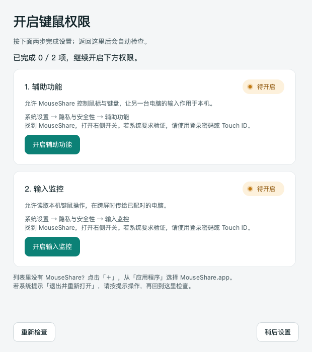
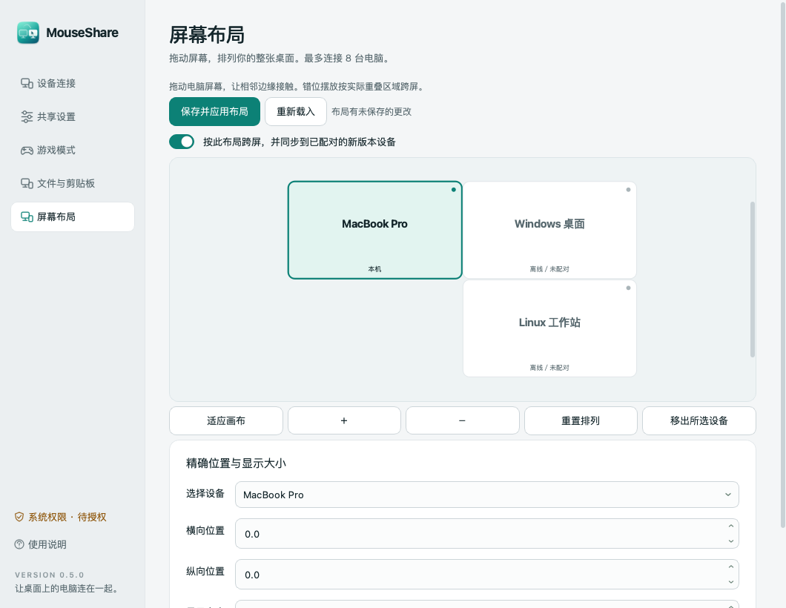
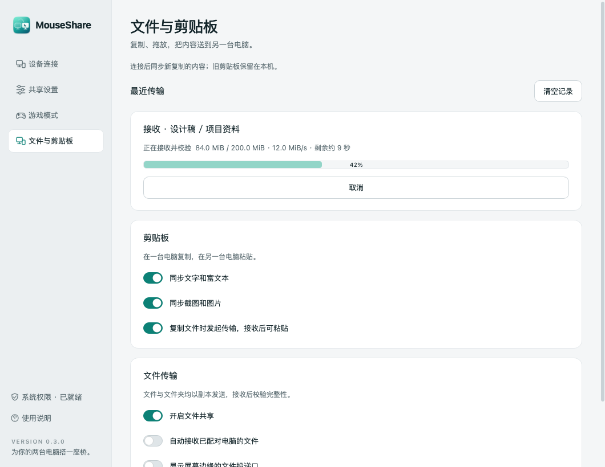
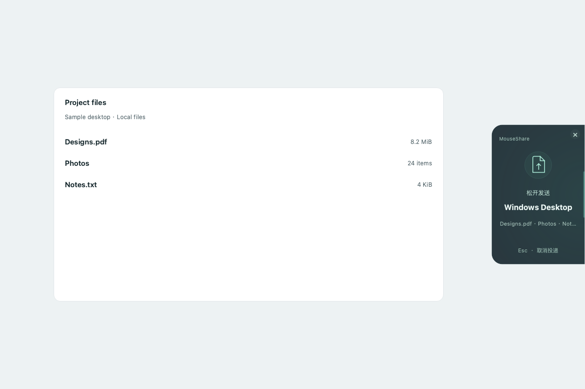
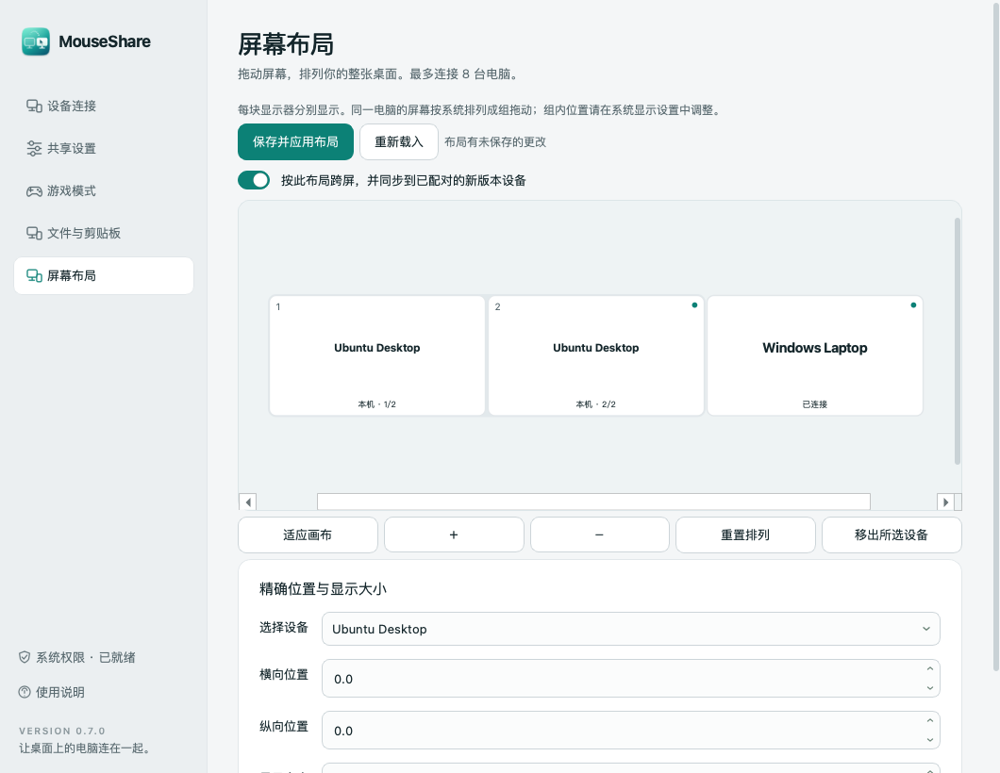

# MouseShare

[简体中文](README.md) · [English](README.en.md)

Windows / macOS / Linux（X11）局域网鼠标键盘、剪贴板和文件共享。鼠标在指定屏幕边缘稍作停留后进入另一台电脑，键盘随之切换；沿原路移回即可返回。

[下载安装包](https://github.com/413180794/MouseShare/releases) · [构建记录](https://github.com/413180794/MouseShare/actions) · [双机验收清单](docs/ACCEPTANCE.md)

**v0.7.2 为预览版。** 自动测试覆盖真实 TLS 双端／三端通信和控制状态机；真实桌面交互、系统授权及具体游戏环境仍需按验收清单确认。Linux 暂无实体电脑验收，CI 使用隔离 Xvfb 验证。


## 界面语言

Windows、macOS 和 Linux 均支持简体中文与英文。首次启动跟随系统语言：中文系统显示简体中文，其他系统显示英文。在 **共享设置 → 本机偏好 → 界面语言** 中可选择「跟随系统」「简体中文」或「English」，立即生效并自动记住；当前连接、传输任务和未保存的设置会保留。使用说明会打开对应语言的 README。macOS 系统授权弹窗的语言跟随操作系统。

## 安装

| 电脑 | 下载文件 | 安装方式 |
| --- | --- | --- |
| Windows 10/11 x64 | `MouseShare-0.7.2-Windows-x64-Setup.exe` | 运行安装程序，保留专用网络防火墙规则 |
| Apple Silicon Mac，macOS 13+ | `MouseShare-0.7.2-macOS-arm64.dmg` | 打开 DMG，拖入「应用程序」 |
| Intel Mac，macOS 13+ | `MouseShare-0.7.2-macOS-x86_64.dmg` | 打开 DMG，拖入「应用程序」 |
| Linux x64，Ubuntu 22.04+ / Debian 12+ | `MouseShare-0.7.2-Linux-x64.deb` 或 `.tar.gz` | `sudo apt install ./文件名.deb`；便携包解压运行 |
| Linux ARM64，Ubuntu 24.04+ / Debian 13+ | `MouseShare-0.7.2-Linux-arm64.deb` 或 `.tar.gz` | 同上 |
| Windows 便携版 | `MouseShare-0.7.2-Windows-x64-portable.zip` | 完整解压后运行 `MouseShare.exe` |

所有包都包含运行依赖，使用者无需安装 Python。Windows 安装程序仅在安装及添加防火墙规则时请求管理员权限，应用以普通用户身份运行。

预览版尚无商业代码签名／Apple 公证。请核对下载来源及 Release 中 `SHA256SUMS.txt`：Windows 可用 `Get-FileHash 文件名 -Algorithm SHA256`，Mac 可用 `shasum -a 256 文件名`。Windows SmartScreen 显示未知发布者时，可查看「更多信息」；macOS 拦截时，先尝试启动，再到「系统设置 → 隐私与安全性」查看「仍要打开」。保留系统安全功能。

macOS 首次运行缺少权限时，会显示设置向导；也可点击首页「设置键鼠权限」或侧栏「系统权限」。向导分两步显示状态，并提供原生授权请求及对应系统设置入口：

1. **辅助功能**：允许注入鼠标键盘事件。
2. **输入监控**：允许捕获实体鼠标键盘。
3. **本地网络**：系统询问时允许；启用防火墙的 Mac 还需允许入站连接。

在系统设置中找到 MouseShare，打开开关；列表中没有时点击「＋」，选择「应用程序」中的 MouseShare.app。系统要求重新启动时，按提示退出并重新打开。返回向导后会自动检查，也可点击「重新检查」。系统验证需要由电脑使用者完成。每次替换未经开发者签名的预览版，macOS 可能要求重新授权。



Linux 完整键鼠共享使用 **X11／Xorg** 会话，以当前登录桌面的普通用户运行。Wayland 提供文件传输与前台手动剪贴板操作；完整键鼠共享请注销后在登录会话中选择 X11／Xorg。Linux 无需 root、input 组或放宽 X11 访问控制。系统依赖、便携安装与开机启动见 [Linux 安装说明](docs/INSTALL-Linux.txt)。

Linux 便携包在精简桌面缺少 Qt／X11 依赖时，可安装以下系统库；DEB 会自动解析完整依赖：

```bash
sudo apt install libx11-6 libxi6 libxtst6 libxfixes3 libxrandr2 libxss1 \
  libxkbcommon-x11-0 libxcb-cursor0 libxcb-icccm4 libxcb-image0 \
  libxcb-keysyms1 libxcb-shape0 libxcb-render-util0 libxcb-xinerama0 \
  libegl1 libopengl0 libdbus-1-3
```

## 两台电脑首次连接

1. 两台电脑加入同一可信局域网，并分别启动 MouseShare。
2. 在「设备连接 → 附近的设备」中选择对方，点击「配对并连接」。发现通过局域网组播和广播完成。
3. **核对两台电脑显示相同的六位配对码，在两端分别确认。** 仅确认自己发起的连接；成功后记住设备证书，自动重连。
4. 打开「屏幕布局」，用鼠标拖动电脑矩形，按实际摆放让边缘接触，再点「保存并应用布局」。可设置上下、左右、错位和不同显示大小，布局自动同步到参与布局的已配对 v0.5.0+ 设备。关闭布局时可继续使用原来的双机方向设置。
5. 鼠标移到相接显示器的重叠区域，停留默认 180ms 后跨屏，键盘随之切换。可连续从 A→B→C，再沿布局返回。未接触、无重叠或离线的区域会停住。每两台需要直接控制或传文件的电脑均需独立配对；最多 8 台。

自动发现受路由器客户端隔离、不同子网、VPN 或防火墙影响时，可展开「通过 IP 连接」并输入对方 IPv4 手动连接。使用端口：**UDP 24871 / TCP 24872**。Windows 安装程序的可选规则仅允许专用网络的本地子网入站。更换 Wi-Fi 后应检查网络是否为「专用」。

## 游戏模式与收回控制

| 操作 | Windows | Mac | Linux X11 |
| --- | --- | --- | --- |
| 切换手动游戏模式 | `Ctrl + Alt + F12` | `Control + Option + F12`（部分键盘需 Fn） | `Ctrl + Alt + Shift + G` |
| 立即收回键鼠 | `Ctrl + Alt + Esc` | `Control + Option + Esc` | `Ctrl + Alt + Shift + Esc` |

界面和托盘／菜单栏均有对应按钮。**游戏模式会暂停本机与远端的双向共享，把实体键鼠留在本机。** 手动开关持久保存，重启应用仍保持。

Windows 自动检测前台全屏窗口及游戏进程。默认已加入 32 组常见游戏，包括三角洲行动、英雄联盟／云顶之弈、无畏契约、CS2、PUBG、Apex、Fortnite、守望先锋、永劫无间、原神、星穹铁道、绝区零、漫威争锋、黑神话：悟空、ARC Raiders、战地 6 等。[完整进程名单](docs/GAMES.md)。旧版原始默认名单会自动扩展；自定义名单保留，可点击「补齐热门游戏名单」后保存。游戏进程名可在设置中用分号分隔。全屏视频也会触发，可关闭全屏检测并保留进程检测。Mac 和 Linux 当前提供手动游戏模式。Linux 使用三键组合避开虚拟终端快捷键。自动保护和游戏进程名单位于独立的「游戏模式」页面。

当自动检测仍在触发时，关闭手动开关会继续保持游戏模式，界面显示触发原因。最稳妥的使用方式是在启动游戏前主动打开游戏模式。反作弊系统可能限制输入钩子或合成输入，具体游戏需要实机验证。

正在接收控制的电脑检测到自己的实体鼠标或键盘活动时，会立即收回控制。按键／鼠标按钮按住期间暂停跨屏，避免拖动到边缘造成意外切换。断线或心跳超时约 3.5 秒会释放远端按键，并将源端控制恢复本机。

## 日常使用

- 关闭窗口后常驻系统托盘／菜单栏，从菜单「退出」结束进程。
- 在设置中主动开启「登录电脑后自动启动」；Mac 先将应用移入 `/Applications`。
- 调整边缘停留时间 100–1500ms 和接收端鼠标速度 0.25–4 倍。
- 字母、数字、常用符号、F1–F12、方向／导航键、数字小键盘和修饰键通过 USB HID 物理键位映射。中文输入由**接收端输入法**处理，布局跟随接收端。
- 默认保留物理修饰键：Windows 键对应 Mac Command，Ctrl 对应 Control。可以在接收端开启「交换 Ctrl 与 ⌘ / Win」以沿用另一台电脑的复制粘贴习惯。
- 取消配对应在两端分别操作。支持同时连接另外 7 台电脑；原机保持实体输入捕获，直接与当前目标通信。
- 交出控制后源端光标隐藏，返回、断线、暂停和游戏模式时恢复。接收端默认显示青绿光圈，可在共享设置中切换颜色或关闭。



## 文件与剪贴板

文字、富文本和图片在连接后复制即可同步。专用复制／粘贴键现为三键组合，原四键组合继续兼容。文件在目标窗口粘贴时按需传输：在源端复制后，到目标端按 Ctrl+Alt+V，可直接接收并粘贴。也可使用专用复制键 Ctrl+Alt+C，Mac 对应 Control+Option+C／V。可选开启系统 Ctrl+V／⌘V；仅有新收到的文件信息时接管。自动粘贴要求目标窗口、输入活动和剪贴板保持原状态；还可拖进软件；开启边缘投递后，将文件拖到相邻电脑的边缘会在拖入点附近显示小范围毛玻璃边缘提示，光晕与图案轻缓呼吸，投递区域固定；松手发送、Esc 取消，平时保持隐藏，在接收端从记录拖出。提供进度／速度、取消、重新发送、接收目录、同名保护和本机记录。游戏模式与暂停同时停止内容共享。

[操作方式、容量限制与后续计划](docs/SHARING.md)。内容共享兼容 v0.3.0+；Linux 端使用 v0.4.0+；多机布局和按需文件粘贴要求参与设备均为 v0.5.0+。Wayland 通过「同步当前剪贴板／应用收到的剪贴板」按钮在前台操作。文件拖放采用边缘投递提示交接，接收完成后拖入本机应用。Mac 和 Windows 11 优先使用系统原生模糊；其他桌面及关闭系统透明效果时提供深色半透明背景。此效果通过系统合成器完成，无需屏幕录制权限。


可选开启「预先接收文件」：每次最多 64 MiB，完整接收和校验后写入系统文件剪贴板，可使用右键「粘贴」。复制后请等待接收完成；本机期间有新复制内容时不会覆盖。大文件用共享粘贴键按需接收。

也可在软件中开启右键扩展：Windows 11 在「显示更多选项」中选择「接收文件到此处（MouseShare）」；Ubuntu GNOME 安装 `python3-nautilus` 并重新打开文件管理器后使用。它将文件存入所选目录的独立批次文件夹，保留现有文件。关闭扩展可撤销注册；Linux 卸载前请先关闭此选项。

笔记本不需要外接键盘或鼠标：用触控板跨屏，或按 `Ctrl+Alt+空格` 主动切换到所选电脑（Mac 为 Control+Option+Space）；再次按下收回控制。按设备页的「切换控制到此电脑」也可切换。物理输入仍采用单一来源，接收端直接操作键鼠会收回控制。





## 范围与限制

- Windows／Mac／X11 读取全部活动显示器，跨屏交接与返回使用真实显示器边界；显示器热插拔时安全收回控制并更新信息。
- 适用于已登录的交互桌面。锁屏、登录界面、UAC 安全桌面、macOS Secure Input 及更高权限的程序可能阻止捕获／注入。[Windows SendInput 权限说明](https://learn.microsoft.com/en-us/windows/win32/api/winuser/nf-winuser-sendinput)。
- 每块显示器会分别显示，保留系统中的相对位置并按电脑成组拖动。组内位置在系统显示设置调整；旧布局可点「重置排列」后保存以采用新的整体比例。支持负坐标、错位和外侧显示器跨屏，同一电脑的内部屏幕切换交给系统。独立拖动同一电脑的每块显示器、连续原生文件跨屏拖动、断点续传、屏幕视频和 Windows ARM 包属于后续范围。
- 自动发现依赖可达的局域网；同 Wi-Fi 下的「访客隔离」需要关闭或改用允许设备互通的网络。

## 数据与安全设计

输入、剪贴板及文件通过 TCP 上的 TLS 1.2+ 加密。每台设备首次启动生成独立 P-256 证书和私钥；双方先提交随机挑战的承诺，再交换证书／挑战并签名证明私钥所有权，生成六位核对码。用户在两端确认后保存证书 SHA-256 指纹。自动重连精确匹配身份；发现数据只用于寻找地址。

首次配对安全依赖用户核对两端数字；拒绝陌生请求。协议是本项目实现，尚未接受独立安全审计，建议用于可信家庭或办公局域网。单个连接的输入帧大小、类型、数值和队列长度均有边界检查；所有权确认前不发送输入。

没有云端中转或账号服务；应用不会把按键内容写入日志或配置。广播的设备名称／IP 可由同一局域网内设备看到。

| 系统 | 本机数据 |
| --- | --- |
| Windows | `%LOCALAPPDATA%\MouseShare` |
| macOS | `~/Library/Application Support/MouseShare` |
| Linux | `${XDG_CONFIG_HOME:-~/.config}/MouseShare` |

目录保存 `settings.json`、`transfers.json` 传输元数据、设备证书与私钥，应按敏感本机数据保护。macOS 使用用户私有目录／文件权限；Windows 使用当前用户目录的系统 ACL。卸载保留数据，方便重装；完全清除时先关闭登录启动、退出应用并删除该目录。Mac 登录项文件为 `~/Library/LaunchAgents/io.github.makesail.mouseshare.plist`；Linux 使用 `${XDG_CONFIG_HOME:-~/.config}/autostart/mouseshare.desktop`。

## 开发与验证

Python 3.13 为正式打包运行时，依赖直接固定版本；PySide6 使用动态 Qt 库，原生输入层独立于界面线程。

```bash
python3.13 -m venv .venv
# macOS: source .venv/bin/activate
# Windows PowerShell: .venv\Scripts\Activate.ps1
python -m pip install ".[dev]"
python -m pytest -q
python -m ruff check .
python -m mouseshare --smoke-test
python -m mouseshare
```

`--demo` 仅显示界面，`--minimized` 启动到托盘。开发运行时的 macOS 授权可能归属于终端／Python；用户应使用打包后的 `.app` 授权。

```bash
python scripts/build.py
```

Windows 构建需安装 Inno Setup 6；Mac 构建需命令行开发工具和 `iconutil`；Linux 使用 `dpkg-deb` 并安装 X11／Qt 系统库。必须在对应操作系统及架构构建。GitHub Actions 自动测试、生成 Windows Setup／ZIP 和两种架构的 Mac DMG、两种 Linux 架构的 DEB／tar.gz、运行打包程序的依赖检查；推送 `v*` 标签后发布预览版及 SHA-256。

目录：`mouseshare/engine.py` 管理输入所有权与游戏模式，`network.py` 管理发现／TLS／心跳，`security.py` 管理配对身份，`input/` 实现 Win32、Quartz 和 XInput2／XTEST 接口，`app.py` 提供控制界面。

MIT。第三方组件许可见 [THIRD_PARTY.md](THIRD_PARTY.md) 及安装包中的 `licenses` 目录。





输入诊断默认关闭。排查间歇性跨屏时，可运行 `MouseShare --diagnostics` 为当前实例临时开启，在本机数据目录读取 `input-health.json`。仅保存状态、数量和阻塞类别，不包含键值、鼠标轨迹、剪贴板内容或对端标识。退出进程后恢复默认。
