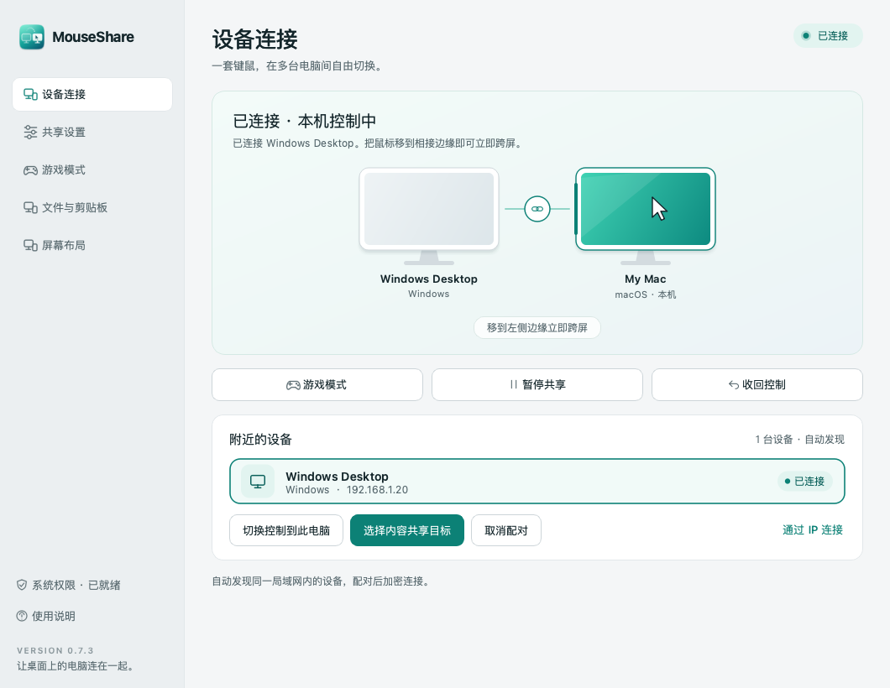

# MouseShare

Windows / macOS 局域网鼠标键盘共享。鼠标在指定屏幕边缘稍作停留后进入另一台电脑，键盘随之切换；沿原路移回即可返回。

[下载安装包](https://github.com/413180794/MouseShare/releases) · [构建记录](https://github.com/413180794/MouseShare/actions) · [双机验收清单](docs/ACCEPTANCE.md)

**v0.1.1 为预览版。** 自动测试覆盖真实 TLS 双端通信和控制状态机；实体 Windows ↔ Mac 的交互、系统授权及具体游戏环境仍需按验收清单确认。



## 安装

| 电脑 | 下载文件 | 安装方式 |
| --- | --- | --- |
| Windows 10/11 x64 | `MouseShare-0.1.1-Windows-x64-Setup.exe` | 运行安装程序，保留专用网络防火墙规则 |
| Apple Silicon Mac，macOS 13+ | `MouseShare-0.1.1-macOS-arm64.dmg` | 打开 DMG，拖入「应用程序」 |
| Intel Mac，macOS 13+ | `MouseShare-0.1.1-macOS-x86_64.dmg` | 打开 DMG，拖入「应用程序」 |
| Windows 便携版 | `MouseShare-0.1.1-Windows-x64-portable.zip` | 完整解压后运行 `MouseShare.exe` |

所有包都包含运行依赖，使用者无需安装 Python。Windows 安装程序仅在安装及添加防火墙规则时请求管理员权限，应用以普通用户身份运行。

预览版尚无商业代码签名／Apple 公证。请核对下载来源及 Release 中 `SHA256SUMS.txt`：Windows 可用 `Get-FileHash 文件名 -Algorithm SHA256`，Mac 可用 `shasum -a 256 文件名`。Windows SmartScreen 显示未知发布者时，可查看「更多信息」；macOS 拦截时，先尝试启动，再到「系统设置 → 隐私与安全性」查看「仍要打开」。保留系统安全功能。

macOS 首次运行，点击「授权 / 重新检查权限」，为 MouseShare 开启：

1. **辅助功能**：允许注入鼠标键盘事件。
2. **输入监控**：允许捕获实体鼠标键盘。
3. **本地网络**：系统询问时允许；启用防火墙的 Mac 还需允许入站连接。

系统要求重新启动时，先从菜单栏退出再打开。授权后点击重新检查。每次替换未经开发者签名的预览版，macOS 可能要求重新授权。

## 两台电脑首次连接

1. 两台电脑加入同一可信局域网，并分别启动 MouseShare。
2. 在「附近的电脑」中选择对方，点击「配对 / 连接所选电脑」。发现通过局域网组播和广播完成。
3. **核对两台电脑显示相同的六位配对码，在两端分别确认。** 仅确认自己发起的连接；成功后记住设备证书，自动重连。
4. 两端分别设置「对方在本机的」方向并保存。例如 Mac 放在 Windows 右边：Windows 选「右侧」，Mac 选「左侧」。
5. 鼠标移到所选主屏边缘，停留默认 180ms 后跨屏。键盘输入、点击、拖动、双击、滚轮一起切换。沿进入方向的相反边缘向外移动即可回到原机。

自动发现受路由器客户端隔离、不同子网、VPN 或防火墙影响时，可输入对方 IPv4 手动连接。使用端口：**UDP 24871 / TCP 24872**。Windows 安装程序的可选规则仅允许专用网络的本地子网入站。更换 Wi-Fi 后应检查网络是否为「专用」。

## 游戏模式与收回控制

| 操作 | Windows | Mac |
| --- | --- | --- |
| 切换手动游戏模式 | `Ctrl + Alt + F12` | `Control + Option + F12`（部分键盘需 Fn） |
| 立即收回键鼠 | `Ctrl + Alt + Esc` | `Control + Option + Esc` |

界面和托盘／菜单栏均有对应按钮。**游戏模式会暂停本机与远端的双向共享，把实体键鼠留在本机。** 手动开关持久保存，重启应用仍保持。

Windows 还自动检测前台全屏窗口及配置中的游戏进程，例如 `League of Legends.exe`、`VALORANT-Win64-Shipping.exe`、`cs2.exe`。游戏进程名可在设置中用分号分隔。全屏视频也会触发，可关闭全屏检测并保留进程检测。Mac 当前提供手动游戏模式。

当自动检测仍在触发时，关闭手动开关会继续保持游戏模式，界面显示触发原因。最稳妥的使用方式是在启动游戏前主动打开游戏模式。反作弊系统可能限制输入钩子或合成输入，具体游戏需要实机验证。

正在接收控制的电脑检测到自己的实体鼠标或键盘活动时，会立即收回控制。按键／鼠标按钮按住期间暂停跨屏，避免拖动到边缘造成意外切换。断线或心跳超时约 3.5 秒会释放远端按键，并将源端控制恢复本机。

## 日常使用

- 关闭窗口后常驻系统托盘／菜单栏，从菜单「退出」结束进程。
- 在设置中主动开启「登录电脑后自动启动」；Mac 先将应用移入 `/Applications`。
- 调整边缘停留时间 100–1500ms 和接收端鼠标速度 0.25–4 倍。
- 字母、数字、常用符号、F1–F12、方向／导航键、数字小键盘和修饰键通过 USB HID 物理键位映射。中文输入由**接收端输入法**处理，布局跟随接收端。
- 默认保留物理修饰键：Windows 键对应 Mac Command，Ctrl 对应 Control。可以在接收端开启「交换 Ctrl 与 ⌘ / Win」以沿用另一台电脑的复制粘贴习惯。
- 取消配对应在两端分别操作。每个应用当前同时连接一台电脑。

## 范围与限制

- 当前跨屏边界使用**主显示器**；本机仍可正常使用其他显示器，远端虚拟鼠标限制在目标主显示器。
- 适用于已登录的交互桌面。锁屏、登录界面、UAC 安全桌面、macOS Secure Input 及更高权限的程序可能阻止捕获／注入。[Windows SendInput 权限说明](https://learn.microsoft.com/en-us/windows/win32/api/winuser/nf-winuser-sendinput)。
- 剪贴板同步、跨机文件拖放、屏幕视频传输和 Windows ARM 原生包属于后续范围。
- 自动发现依赖可达的局域网；同 Wi-Fi 下的「访客隔离」需要关闭或改用允许设备互通的网络。

## 数据与安全设计

所有输入通过 TCP 上的 TLS 1.2+ 加密。每台设备首次启动生成独立 P-256 证书和私钥；双方先提交随机挑战的承诺，再交换证书／挑战并签名证明私钥所有权，生成六位核对码。用户在两端确认后保存证书 SHA-256 指纹。自动重连精确匹配身份；发现数据只用于寻找地址。

首次配对安全依赖用户核对两端数字；拒绝陌生请求。协议是本项目实现，尚未接受独立安全审计，建议用于可信家庭或办公局域网。单个连接的输入帧大小、类型、数值和队列长度均有边界检查；所有权确认前不发送输入。

没有云端中转或账号服务；应用不会把按键内容写入日志或配置。广播的设备名称／IP 可由同一局域网内设备看到。

| 系统 | 本机数据 |
| --- | --- |
| Windows | `%LOCALAPPDATA%\MouseShare` |
| macOS | `~/Library/Application Support/MouseShare` |

目录保存 `settings.json`、设备证书与私钥，应按敏感本机数据保护。macOS 使用用户私有目录／文件权限；Windows 使用当前用户目录的系统 ACL。卸载保留数据，方便重装；完全清除时先关闭登录启动、退出应用并删除该目录。Mac 登录项文件为 `~/Library/LaunchAgents/io.github.makesail.mouseshare.plist`。

## 开发与验证

Python 3.13 为正式打包运行时，依赖直接固定版本；PySide6 使用动态 Qt 库，原生输入层独立于界面线程。

```bash
python3.13 -m venv .venv
# macOS: source .venv/bin/activate
# Windows PowerShell: .venv\Scripts\Activate.ps1
python -m pip install ".[dev]"
python -m pytest -q
python -m ruff check .
python -m mouseshare --smoke-test
python -m mouseshare
```

`--demo` 仅显示界面，`--minimized` 启动到托盘。开发运行时的 macOS 授权可能归属于终端／Python；用户应使用打包后的 `.app` 授权。

```bash
python scripts/build.py
```

Windows 构建需安装 Inno Setup 6；Mac 构建需命令行开发工具和 `iconutil`。必须在对应操作系统及架构构建。GitHub Actions 自动测试、生成 Windows Setup／ZIP 和两种架构的 Mac DMG、运行打包程序的依赖检查；推送 `v*` 标签后发布预览版及 SHA-256。

目录：`mouseshare/engine.py` 管理输入所有权与游戏模式，`network.py` 管理发现／TLS／心跳，`security.py` 管理配对身份，`input/` 实现 Win32 和 Quartz 接口，`app.py` 提供控制界面。

MIT。第三方组件许可见 [THIRD_PARTY.md](THIRD_PARTY.md) 及安装包中的 `licenses` 目录。

